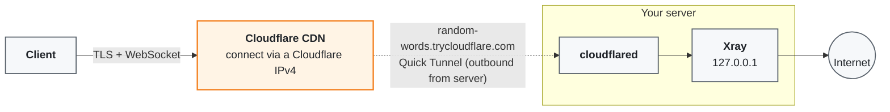

# cf-tunnel-xray

One-command **Xray (VLESS / VMess over WebSocket)** server that is published through a **Cloudflare Quick Tunnel**.
You do **not** need a domain, a TLS certificate, nginx, or any open inbound port. Cloudflare generates a random
`*.trycloudflare.com` hostname for your server and the script turns it into a ready-to-import
`vless://` or `vmess://` link, printed as text **and as a QR code**.



<details>
<summary>Plain-text version</summary>

```
  ┌──────────────────────────┐
  │  Client                  │
  │  Happ, v2rayNG, Hiddify  │
  └────────────┬─────────────┘
               │  TLS + WebSocket to a Cloudflare IPv4
               ▼
  ┌──────────────────────────┐
  │  Cloudflare CDN          │
  │  random-words            │
  │  .trycloudflare.com      │
  └────────────┬─────────────┘
               │  Quick Tunnel (outbound connection from your server)
               ▼
  ┌──────────────────────────┐
  │  Your server             │
  │                          │
  │  cloudflared             │
  │       │                  │
  │       ▼                  │
  │  Xray (127.0.0.1)        │
  └────────────┬─────────────┘
               ▼
           Internet
```

</details>

## Features

- VLESS **or** VMess, chosen at install time
- No domain, no certificate, no inbound ports, no nginx
- Cloudflare IPv4 as the client address (the "clean IP" technique), changeable at any time with `cf-setip`
- Share link **and QR code** in the terminal, plus PNG files
- Built-in test that tells you which link Cloudflare accepts
- Standalone scanner to find Cloudflare IPs that work on your ISP
- Clean uninstall

## Requirements

- A VPS with root access running **Debian or Ubuntu** (systemd), x86_64 / arm64 / armv7
- Outbound access to Cloudflare (TCP/UDP 7844 and `api.trycloudflare.com`)

## Quick start

On the server, as root:

```bash
git clone https://github.com/0xHawre/cf-tunnel-xray.git
cd cf-tunnel-xray
sudo ./install.sh
```

Or non-interactive:

```bash
sudo ./install.sh --protocol vmess --ip 104.19.55.12 --name my-config
```

When it finishes you get two links with QR codes:

| Link | SNI presented to Cloudflare | Notes |
|------|-----------------------------|-------|
| **A** (fronting) | `www.speedtest.net` (configurable) | Usually **rejected** by Cloudflare, see [How it works](docs/HOW-IT-WORKS.md) |
| **B** (normal)   | your `*.trycloudflare.com` domain | The one that normally works |

The installer tests both from the server and marks each one `WORKS` or `REJECTED`. Scan the QR code of the
working link with your client app, or copy the `vless://` / `vmess://` text and use *Import from clipboard*.

## Commands installed on the server

| Command | What it does |
|---------|--------------|
| `cf-show` | Re-test and print both links with QR codes (PNGs in `/root/qr-A.png`, `/root/qr-B.png`) |
| `cf-link [A\|B]` | Print a single link (default `B`) |
| `cf-setip <ipv4>` | Change the Cloudflare IP used in the links, then reprint |

> **The domain changes whenever the tunnel restarts** (reboot, crash, `systemctl restart cf-tunnel`).
> Run `cf-show` again and re-import the new link. This is a limitation of free Quick Tunnels.

## Finding a Cloudflare IP that works on your ISP

Any Cloudflare IP can carry the traffic, but not every IP is reachable from your network. Run the scanner on **your own
device**, not on the server:

```bash
./scripts/cf-scan.sh <your-tunnel-domain> 80 20
```

It prints reachable IPs, fastest first. Apply the best one on the server:

```bash
cf-setip 104.19.55.12
```

The official ranges are published at <https://www.cloudflare.com/ips-v4>.

## Uninstall

```bash
sudo ./uninstall.sh            # remove tunnel, config and helpers
sudo ./uninstall.sh --purge    # also remove Xray
```

## Documentation

- [How it works](docs/HOW-IT-WORKS.md): architecture, link anatomy, why domain fronting is usually rejected
- [Troubleshooting](docs/TROUBLESHOOTING.md): tunnel not starting, link not connecting, rate limits

## Limitations (please read)

- **Quick Tunnels have no uptime guarantee** and are intended by Cloudflare for testing. They can be throttled or
  stopped at any time. For something stable, use your own domain on Cloudflare with a named tunnel.
- The hostname **changes on every tunnel restart**.
- **True domain fronting** (presenting one site's SNI while asking for another site's content) is blocked by Cloudflare.
  Link A exists so you can test it on your network; do not rely on it.
- A single UUID is generated per install. Editing `/usr/local/etc/xray/config.json` and restarting `xray` lets you add more clients.

## Security notes

- Share links contain your UUID. Treat them like passwords and never commit them (the `.gitignore` already excludes
  generated files).
- Xray listens on `127.0.0.1` only, so it is reachable solely through the tunnel.
- Keep the server updated (`apt upgrade`) and use SSH keys.

## Responsible use

Use this only on servers you own or are authorized to administer, and in compliance with local law,
your hosting provider's terms, and [Cloudflare's terms of service](https://www.cloudflare.com/website-terms/).
The authors provide it as-is, without warranty.

## Credits

[Xray-core](https://github.com/XTLS/Xray-core) · [cloudflared](https://github.com/cloudflare/cloudflared) · [qrencode](https://fukuchi.org/works/qrencode/)

## License

[MIT](LICENSE)
